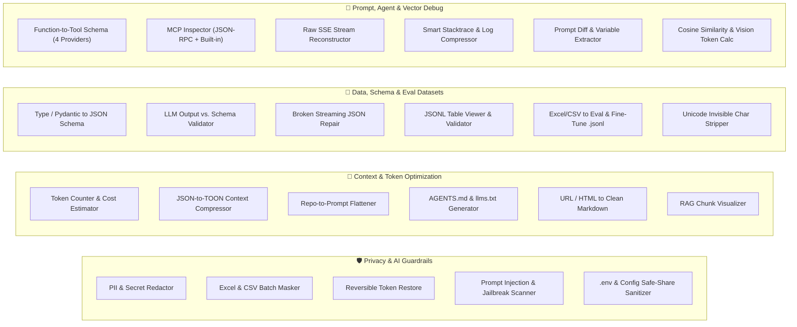

# 🛠️ AI Dev Workbench (`v2.0`)

**22 Offline AI-Centric Developer Utilities + Enterprise PII/Secret Guardrails**  
Powered by [data-privacy-stack/presidio](https://github.com/data-privacy-stack/presidio) (`presidio-analyzer` + `presidio-anonymizer`), `spaCy` (`en_core_web_sm`), Thai Custom Recognizers (Modulo-11 National ID Checksum, 3-Part Thai Honorific Names, Thai Grapheme Cluster Segmentation), and a 16-Worker Parallel Execution Engine.

Runs **100% Offline Locally** as a native **macOS (`.dmg` / `.app`)** and **Windows (`.exe`)** Desktop Application, or as a containerized **FastAPI Production Web Service**.

---

## ✨ Key Highlights

- **🔒 100% Offline & Zero Data Exfiltration**: Every PII scan, Excel batch job, and AI utility runs locally on your machine.
- **🇹🇭 + 🌐 Deep Thai & English PII Support**:
  - **Thai Identity**: 13-digit Thai National ID (with Modulo-11 Checksum verification), Thai Laser ID, Thai Person Names (1–3 name parts after honorifics, while avoiding false positives on `บริษัท ...` company names), Thai Mobile/Landline Phone Numbers, Thai Addresses, Thai Vehicle License Plates.
  - **Financial & Banking**: Thai Bank Account Numbers (10–12 digits), Credit/Debit Cards (Luhn checksum), IBAN Codes.
  - **Global Identity & Contact**: English `PERSON` (spaCy NER), `EMAIL_ADDRESS`, International `PHONE_NUMBER`, `US_SSN`, `PASSPORT`, `LOCATION`.
  - **Credentials & Network**: `API_KEY_SECRET` (OpenAI `sk-...`, Anthropic `sk-ant-...`, AWS `AKIA...`, GitHub `ghp_...`, JWT `eyJ...`, Bearer tokens, Private keys), `IP_ADDRESS`, `URL`.
- **🎛️ 7 Flexible Masking Modes + Per-Entity Overrides**:
  1. **Partial Mask — Keep Prefix/Suffix (`keep_prefix_suffix`)**: Keep first $N$ and last $M$ grapheme clusters (`081-234-5678` → `08*******678` or `081-***-**78` with separator preservation).
  2. **Inverse Partial Mask (`mask_prefix_suffix`)**: Mask only the first $N$ and last $M$ characters (`081-234-5678` → `**1-234-5***`).
  3. **Reversible Token Mapping (`token`)**: Deterministic bidirectional tokens (`[TH_PERSON_NAME_1]`, `[TH_PHONE_NUMBER_1]`) with 1-click **Token Restore** for both text and multi-sheet Excel workbooks.
  4. **Entity Tag Replace (`replace`)**: `<TH_NATIONAL_ID>`, `<EMAIL_ADDRESS>`.
  5. **Standard Mask (`mask`)**: Mask $N$ characters from start or end.
  6. **Redact (`redact`)**: Complete removal or `[REDACTED]`.
  7. **Cryptographic Hash (`hash`)**: `SHA-256`, `SHA-512`, or `MD5` with custom salt.

---

## 🧰 Complete Suite of 22 Tools + 4 Separated Settings Views



| Category | Tool Name | Purpose |
| :--- | :--- | :--- |
| **Privacy & AI Guardrails** | **🛡️ PII & Secret Redactor** | Interactive text/code PII redaction with per-detection toggle chips |
| | **📊 Excel & CSV Masker** | Multi-sheet `.xlsx` & `.csv` batch masking with RFC 5987 Thai filename support |
| | **🔓 Token Restore** | Lossless restoration of `[ENTITY_N]` tokens across text, `.xlsx`, and `.csv` |
| | **🚨 Prompt Injection Guard** | Detects Instruction Override, DAN Jailbreak, ChatML Escape & Markdown Exfiltration |
| | **🔐 `.env` & Config Sanitizer** | Scrubs DB URI passwords & API keys in `.env`/YAML/JSON while keeping keys intact |
| **Context & Token** | **🧮 Token & Cost Calculator** | Thai/English-aware token & USD/THB cost estimator across GPT-4o, Claude, Gemini, DeepSeek |
| | **📉 JSON / TOON Compressor** | Converts verbose JSON arrays to TOON, Markdown Table, or TSV (45–65% token savings) |
| | **📦 Repo to Prompt** | Parallel codebase flattener (`repomix` style) with directory tree & token estimate |
| | **🧭 `AGENTS.md` & `llms.txt`** | Scans project structure to generate `AGENTS.md`, `CLAUDE.md`, and `llms.txt` |
| | **📄 URL / HTML to Markdown** | Strips ads, scripts, and HTML tags into clean RAG-ready Markdown |
| | **✂️ Chunk Visualizer** | Visualizes `chunk_size` & `chunk_overlap` with mid-sentence truncation warnings |
| **Data & Schema** | **🔄 Encoding & Format Converter** | Converts `UTF-8` ↔ `UTF-8 with BOM (Excel Safe)` ↔ `TIS-620/CP874` ↔ `UTF-16`, repairs Thai Mojibake, & converts `CSV` ↔ `TSV`/`XLSX`/`JSONL`/`SQL` |
| | **📐 Type to JSON Schema** | Converts TypeScript interfaces & Python Pydantic models to OpenAI Strict JSON Schema |
| | **✅ Schema Output Validator** | Validates LLM JSON responses against JSON Schema + builds Self-Correction Prompts |
| | **🔧 Broken JSON Repair** | Repairs truncated streaming JSON, unclosed quotes, trailing commas, and Python booleans |
| | **📋 JSONL Table Viewer** | Parses and validates `.jsonl` fine-tuning & batch files into an interactive table |
| | **🗂️ Eval & Fine-Tune `.jsonl`** | Converts QA CSV/Excel rows into OpenAI/ShareGPT/Promptfoo `.jsonl` with auto PII scrubbing |
| | **🧹 Unicode Cleaner** | Detects and strips Zero-Width Spaces (`U+200B`), BOM (`U+FEFF`), and BiDi control chars |
| **Prompt & Agent Debug** | **🧰 Function to Tool Schema** | Converts Python/TS functions & docstrings into OpenAI, Claude, Gemini & MCP tool schemas |
| | **🔌 MCP Inspector** | Tests Model Context Protocol JSON-RPC servers (`initialize`, `tools/list`, `tools/call`) |
| | **🕵️‍♂️ SSE Stream Reconstructor** | Reassembles raw `data: {...}` streaming chunks into text, reasoning, and tool calls |
| | **🪵 Smart Log Compressor** | Deduplicates repeated log lines, collapses internal frames, and scrubs PII in logs |
| | **⚖️ Prompt Diff** | Word-level prompt comparison with `{{variable}}` extraction and token delta |
| **Vector & Media** | **🧭 Cosine Similarity** | Hybrid subword 3-gram + lexical cosine similarity & missing keyword debugger for RAG |
| | **🖼️ Image Token & Resizer** | Calculates GPT-4o, Claude 3.7 & Gemini 2.5 vision tokens + in-browser image resizer |
| **Settings (4 Separated Views)** | **🎯 Detection Entities** | 5 separate domain cards (`Thai Identity`, `Financial`, `Global`, `Credentials`, `Custom`) |
| | **🎛️ Masking & Overrides** | Confidence score threshold slider + Per-Entity Masking Overrides |
| | **🧩 Custom Regex & Rules** | Create/test/delete custom Regex & Deny-list recognizers with Live Rule Tester |
| | **🧪 System & Auto-Test** | Runtime diagnostics, cache management, and 1-click **27-Action Automated E2E Self-Test** |

---

## 🚀 Quick Start

### Option 1: Native Desktop Installers (`dist/`)
- **macOS**: Open `dist/PresidioShield-macOS.dmg` or launch `dist/PresidioShield.app`
- **Windows**: Run `dist/PresidioShield-Setup-x64.exe` or `dist/PresidioShield-Portable-x64.exe`

### Option 2: Run from Source (macOS / Linux / Windows)
```bash
python3 -m venv .venv
source .venv/bin/activate
pip install -r requirements.txt

# Launch native desktop window (or browser fallback)
python desktop.py
```

### Option 3: Production Docker Deployment
```bash
docker compose up --build -d
# Open http://localhost:18765
```

---

## 🧪 Automated Testing

Run the full automated test suite (15 pytest modules + 27 end-to-end self-test assertions + DOM ID integrity check):

```bash
.venv/bin/python -m pytest -v
```

Or trigger the live self-test via API:
```bash
curl -X POST http://127.0.0.1:18765/api/system/self-test
```

---

## 📦 Building Desktop Installers (`.dmg` & `.exe`)

```bash
.venv/bin/python build_installers.py
```
Outputs ready-to-distribute packages in `dist/`:
- `dist/PresidioShield.app` (macOS Universal Application Bundle)
- `dist/PresidioShield-macOS.dmg` (macOS Disk Image Installer)
- `dist/PresidioShield-Setup-x64.exe` (Windows x64 Self-Extracting Installer)
- `dist/PresidioShield-Portable-x64.exe` (Windows x64 Portable Executable)

---

## 📄 License
MIT License
